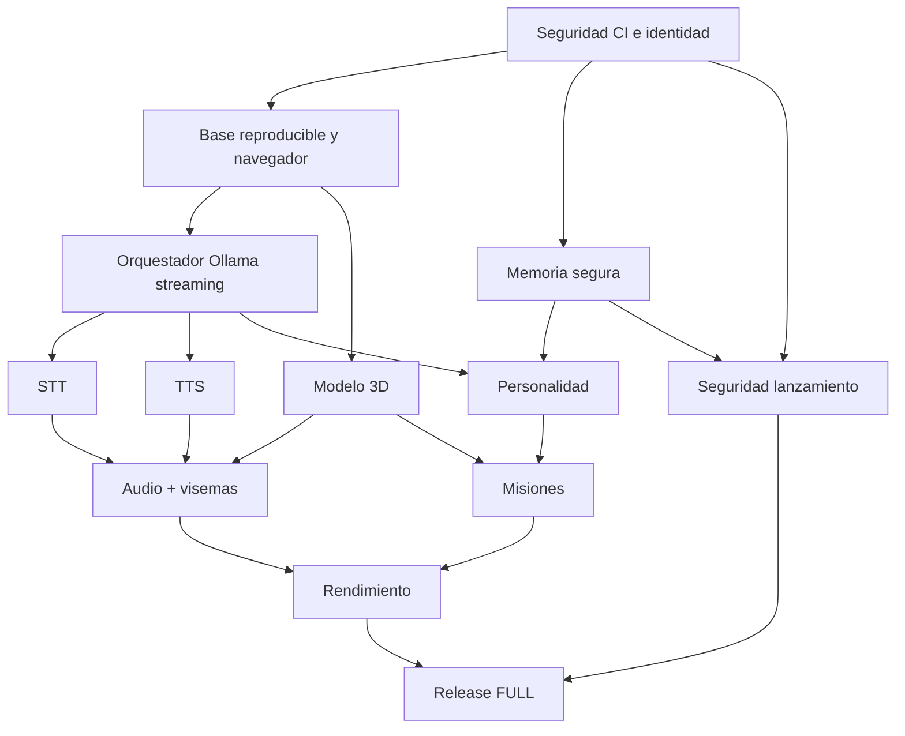

# Daskalov — Plan maestro FULL de implementación ODD + TDD

**Versión:** 1.0 · **Fecha:** 2026-11-07 · **Origen:** investigación avanzada «Profesor Daskalov: investigación técnica y plan de mejora».  
**Repositorio:** https://github.com/asenbanskaliev/Daskalov · **Rama:** feat/odd-tdd-web-mvp · **PR:** #1 (draft).  
**HEAD examinado:** 89dc16d492a4d9aa8fdcc0dd37e02cbb00f390cd · **Estado:** PLAN APROBADO TÉCNICAMENTE COMO PROPUESTA; tareas nuevas no ejecutadas.  
**Importante:** este documento ordena el trabajo: no afirma que los componentes descritos ya estén implementados.

## 0. Resultado de producto (ODD)
Construir un **videojuego educativo 3D WEB**, ejecutado desde Chrome/Edge/Firefox con HTML/JS/Three.js sin instalar una app, un profesor búlgaro ficticio **Daskalov** que conversa libremente mediante Ollama Cloud/local, recuerda cuando está autorizado y habla con voz propia y acento suave de Europa del Este. **No** será solo una interfaz de chat con avatar: habrá aula, cámara, misiones, pizarra, pistas y progreso. Humor nostálgico y absurdo, nunca castigo real, violencia ni humillación.

### Resultado de usuario comprobable
1. Entro en una URL HTTPS y veo un aula con Daskalov, o un modo texto si falta WebGL.
2. Elijo Ollama Cloud o local y modelo; hay estado y error claros. Se respeta local-only.
3. Hablo por micrófono o escribo; veo subtítulos y escucho respuesta con gestos, labios y animación.
4. Puedo interrumpir y el profesor deja de hablar sin superposición.
5. Si me giro reacciona una sola vez de forma divertida, sin repetición agresiva.
6. Puedo resolver al menos tres lecciones con retos de aula y respuestas educativas.
7. Si autorizo memoria de forma válida, recuerda contexto útil; puedo consultar, exportar y borrar todo.
8. Mis datos no se mezclan con los de otros jugadores; la clave Cloud nunca llega a HTML.
9. El juego funciona con latencia y FPS medidos; hay controles accesibles y alternativas.
10. Una versión candidata solo pasa a FULL con los gates finales y revisión humana de privacidad, acento y pedagogía.

## 1. Estado base comprobado, NO duplicar esfuerzo
- **EXISTE:** servidor Node 24, frontend HTML/JS, aula procedural Three.js, selector Cloud/local, Web Speech inicial, prompt de Daskalov, SQLite FTS5 con opt-in básico, y tests mock.
- **PROBADO REAL:** Ollama Cloud Beam + respuesta/gesto/memoria SQL en GitHub Actions: https://github.com/asenbanskaliev/Daskalov/actions/runs/42402678071 (run histórico, SHA cbc742c).
- **CI BASE:** en HEAD examinado, https://github.com/asenbanskaliev/Daskalov/actions/runs/42403142148 y https://github.com/asenbanskaliev/Daskalov/actions/runs/42403138240 fueron SUCCESS.
- **NO VALIDADO:** navegador real con Playwright, voz búlgara, lipsync preciso, rendimiento, Ollama local de extremo a extremo, identidad/consentimiento seguro para menores, publicación pública.
- **RIESGO ALTO ACTUAL:** workflow de secreto autoejecutado en código modificable de rama y endpoints de memoria que confían en UUID aportado por cliente. Remediar **antes** de ampliar/publicar.
- Las casillas ya marcadas en el plan antiguo odd/tasks/plan-maestro-odd-tdd.md reflejan cobertura de **MVP**, no equivalen a FULL. Este plan añade contratos de producción sin borrar esa evidencia.

## 2. Reglas obligatorias ODD + TDD
- **RED → GREEN → REFACTOR:** escribir primero prueba negativa y positiva, registrar su fallo RED, implementar mínimo, pasar GREEN y refactorizar sin romper contratos.
- Cada tarea exige: ID, dependencia satisfecha, código, pruebas automáticas y una observación de uso real cuando corresponda, evidencia SHA + workflow + resultado y actualización de casillas.
- **Estado válido:** TODO, IN_PROGRESS, BLOCKED_EXTERNAL, PARTIAL, VERIFIED, DONE; solo DONE marca `[x]`. PARTIAL no cuenta.
- Cada PR agrupa una *vertical slice* utilizable, idealmente 2-5 tareas dependientes. Seguir con tareas sin esperar CI largo solo si el trabajo es seguro; no declarar éxito hasta conocer resultados.
- PR de funcionalidad contra la rama de desarrollo; **no merge a main sin autorización**. Las credenciales solo se usan en ejecuciones de código de confianza, nunca en forks ni PR no revisados.
- Pruebas mock siempre sin coste. Las pruebas Ollama reales son explícitas, limitadas, etiquetadas y presupuestadas; nunca registran prompts reales de menores, claves ni respuestas privadas.
- Decisión técnica y tradeoff no trivial: registrar ADR; cambios de alcance: actualizar esta lista y tests **antes** de código.
- No perseguir 60 FPS ni primer audio <2 segundos con Beam como garantía: fijar metas diferenciadas y medir.

## 3. Dependencias y ruta crítica

Prioridad de implementación: S00 (protección y no regresión) → S01 (reproducibilidad/E2E) → S02 (streaming y cancelación) → S03/S04 (voz) en paralelo con S05 (3D) → S06 (visemas) + S07 (memoria) → S08/S09 (educación) → S10/S11 → S12.

## 4. Backlog completo ejecutable
**Convención:** todo casillero nuevo comienza desmarcado; los IDs de pruebas se especifican en odd/quality/full-gates-y-contratos.md. `Sxx.yy` = tarea de esta fase. Prioridad P0 bloquea producción, P1 calidad y funcionamiento, P2 ampliación.

### S00 — Control de riesgos y CI con secretos
**Prioridad:** P0 / BLOQUEANTE · **Gate:** SEC-READY · **Dependencias:** ninguna

- [ ] **S00.01** Desactivar ejecución automática con OLLAMA_API_KEY en push de rama editable; pasar a dispatch/trusted main + environment protegido y revisión.  
  - **Aceptación:** Política CI impide secreto en PR/fork o código no revisado.  
  - **TDD:** SEC-001 · **Dep.:** —.
- [x] **S00.02** Fijar permisos de GITHUB_TOKEN a mínimo, checkout sin credenciales persistentes, pin de Actions por SHA y control de terceros.  
  - **Aceptación:** Análisis estático de workflows rechaza privilegios y acciones no aprobadas.  
  - **TDD:** SEC-002 · **Dep.:** 01.
- [x] **S00.03** Implantar pruebas unitarias y workflow policy que fallen si aparece referencia a secrets en workflows no confiables.  
  - **Aceptación:** Fixture PR externo nunca recibe credenciales ni expone variables.  
  - **TDD:** SEC-003 · **Dep.:** 01.
- [x] **S00.04** Añadir autenticación/autorización de sesiones de memoria antes de permitir acceso fuera de localhost.  
  - **Aceptación:** El UUID de cliente no permite leer/borrar recuerdos ajenos.  
  - **TDD:** SEC-004 · **Dep.:** —.
- [ ] **S00.05** Cerrar exposición de Cloud en despliegue público: login/guest con límites, cupos de tokens y concurrencia por sesión.  
  - **Aceptación:** 100 peticiones sin autorización no producen gasto ni degradación.  
  - **TDD:** SEC-005 · **Dep.:** 04.
- [x] **S00.06** Definir entornos de prueba y protección de datos para menores; modo demo sin memoria y sin audio persistente.  
  - **Aceptación:** El modo sin consentimiento no escribe audio, perfil ni transcripciones persistentes.  
  - **TDD:** SEC-006 · **Dep.:** 04.
- [x] **S00.07** Crear registro de riesgos, presupuesto Cloud, criterios no-go y procedimiento de rotación de credenciales.  
  - **Aceptación:** Ensayo de revocación y revisión manual documentados.  
  - **TDD:** SEC-007 · **Dep.:** 01.

### S01 — Proyecto web reproducible, testing en navegadores y UI modular
**Prioridad:** P0 · **Gate:** WEB-READY · **Dependencias:** S00.01-03

- [x] **S01.01** Instalar Three.js con versión fijada, Vite ligero, lockfile npm, builds versionados sin CDN obligatorio.  
  - **Aceptación:** npm ci + npm run build repetibles en Linux/Windows; sin fetch CDN al lanzar.  
  - **TDD:** WEB-001 · **Dep.:** S00.01.
- [x] **S01.02** Modularizar app.js en UI, cámara, input, conversation, audio, animación, ajustes y eventos; sin framework pesado.  
  - **Aceptación:** Cada módulo con contratos públicos y tests; sin regresiones de UX.  
  - **TDD:** WEB-002 · **Dep.:** 01.
- [x] **S01.03** Crear SPA simple de un solo origen servido por Node con assets compilados, cabeceras y caché coherentes.  
  - **Aceptación:** Navegador abre /, recarga y carga módulos sin 404.  
  - **TDD:** WEB-003 · **Dep.:** 01.
- [x] **S01.04** Añadir Playwright Chromium + Firefox: primer render, chat mock, error Ollama, modo texto, micrófono ausente.  
  - **Aceptación:** CI E2E verde en ambos navegadores (sin API keys).  
  - **TDD:** WEB-004 · **Dep.:** 03.
- [x] **S01.05** Implementar panel accesible y responsive para IA Cloud/local, voz, permisos, memoria y rendimiento.  
  - **Aceptación:** Uso con teclado, foco visible, etiquetas y anchura móvil sin solapes.  
  - **TDD:** WEB-005 · **Dep.:** 02.
- [x] **S01.06** Detección de capacidades WebGL2, micrófono y audio, con recuperación explícita y fallback textual.  
  - **Aceptación:** Si falta WebGL/STT/TTS el chat sigue siendo utilizable.  
  - **TDD:** WEB-006 · **Dep.:** 03.
- [ ] **S01.07** Política de accesibilidad WCAG 2.2 AA: subtítulos, transcripción, mute, pausas, reduced-motion y contraste.  
  - **Aceptación:** Auditoría axe + manual teclado con cero defectos críticos.  
  - **TDD:** WEB-007 · **Dep.:** 05.
- [x] **S01.08** Definir modo offline parcial (demo guiada sin inferencia) y estados de conectividad.  
  - **Aceptación:** Sin red externa puede abrir demo; modo IA no simula respuestas como reales.  
  - **TDD:** WEB-008 · **Dep.:** 06.

### S02 — Orquestador de conversación y Ollama real Cloud/local
**Prioridad:** P0 · **Gate:** CONV-READY · **Dependencias:** S00,S01

- [x] **S02.01** Contratos tipados de turn/session/requestID y eventos streaming: started, delta, sentence, gesture, done, error.  
  - **Aceptación:** Parser y schemas rechazan mensajes incompletos, mezclados y fuera de orden.  
  - **TDD:** LLM-001 · **Dep.:** S01.02.
- [x] **S02.02** Adaptador Ollama NDJSON con stream=true, lectura incremental UTF-8 y límites de memoria.  
  - **Aceptación:** Cadenas Unicode cortadas entre chunks se recomponen y terminan sin pérdida.  
  - **TDD:** LLM-002 · **Dep.:** 01.
- [x] **S02.03** AbortController de extremo a extremo y política latest-turn-wins para interrupciones.  
  - **Aceptación:** Turno cancelado no escribe memoria ni voz ni actualiza interfaz.  
  - **TDD:** LLM-003 · **Dep.:** 02.
- [x] **S02.04** SentenceChunker que reconoce puntuación española, topes 80-160 caracteres y flush final.  
  - **Aceptación:** Primer segmento no espera respuesta completa; no pierde signos ni texto.  
  - **TDD:** LLM-004 · **Dep.:** 02.
- [x] **S02.05** Modelo/provider health y validación real de disponibilidad; soporte Cloud local con selección desde ajustes.  
  - **Aceptación:** Se informa por qué no hay modelo y se puede cambiar sin reinicio.  
  - **TDD:** LLM-005 · **Dep.:** S01.05.
- [x] **S02.06** Fallback explícito y consentido Cloud/local con política local-only sin fuga de contenido.  
  - **Aceptación:** Fallo local sin permiso NO envía mensaje a Cloud; con permiso reintenta una vez.  
  - **TDD:** LLM-006 · **Dep.:** 05.
- [x] **S02.07** Resiliencia: timeout por fase, 429/5xx, reconexión, límites tokens, respuestas vacías y cancelación limpia.  
  - **Aceptación:** 100 casos de fallos simulados terminan sin cuelgues ni respuestas duplicadas.  
  - **TDD:** LLM-007 · **Dep.:** 02,03.
- [x] **S02.08** ContextBuilder: personalidad fija, historia autorizada, memoria relevante y eventos verificados por servidor.  
  - **Aceptación:** No supera presupuesto de contexto ni revela instrucciones frente a inyección.  
  - **TDD:** LLM-008 · **Dep.:** S08.01,S07.04.
- [ ] **S02.09** Smoke REAL Cloud con Ollama Beam y conversación completa, solo en ejecución confiable; local real opcional en runner propio.  
  - **Aceptación:** Prueba Cloud live respalda texto, streaming, cancelación y gestos; local live etiquetada.  
  - **TDD:** LLM-009 · **Dep.:** 07,S00.01.
- [x] **S02.10** Métricas de latencia, tokens, coste, estado y errores sin texto personal.  
  - **Aceptación:** Se exportan agregados y no mensajes ni secretos en logs.  
  - **TDD:** LLM-010 · **Dep.:** 07.

### S03 — Reconocimiento de voz STT y turn-taking
**Prioridad:** P1 · **Gate:** STT-READY · **Dependencias:** S01,S02

- [x] **S03.01** Interfaz STT agnóstica: webSpeech, localWhisper, disabled; teclado como ruta universal.  
  - **Aceptación:** Todos los proveedores usan mismo contrato transcript/partial/error.  
  - **TDD:** STT-001 · **Dep.:** S01.02.
- [x] **S03.02** Captura de micrófono con permiso tras gesto, indicadores visibles y stop inmediato.  
  - **Aceptación:** Denegar permiso no rompe el juego ni inicia captura oculta.  
  - **TDD:** STT-002 · **Dep.:** 01.
- [x] **S03.03** VAD opcional y detección de fin de turno configurable sin recortar sílabas.  
  - **Aceptación:** Pruebas de ruido, pausas y ruido ambiental en audio sintético.  
  - **TDD:** STT-003 · **Dep.:** 02.
- [x] **S03.04** Backend STT local (p. ej. whisper.cpp) como opción instalable con licencia y recursos documentados.  
  - **Aceptación:** Transcribe frases en español con calidad medida en corpus de prueba.  
  - **TDD:** STT-004 · **Dep.:** 01.
- [x] **S03.05** Alternativa STT Cloud configurable con aviso de privacidad explícito y consentimiento.  
  - **Aceptación:** Modo local-only nunca transmite audio ni transcripción a Cloud sin permiso.  
  - **TDD:** STT-005 · **Dep.:** S10.02.
- [x] **S03.06** Interrupción/barge-in: al hablar usuario, se cancela síntesis y turno previo.  
  - **Aceptación:** No se superponen respuestas de voz, el usuario recupera control.  
  - **TDD:** STT-006 · **Dep.:** S02.03,S04.06.
- [ ] **S03.07** Pruebas de compatibilidad Chrome/Edge/Firefox y 20 audios difíciles.  
  - **Aceptación:** WER documentado; fallo de STT deja el teclado disponible.  
  - **TDD:** STT-007 · **Dep.:** 04,05.

### S04 — Motor de TTS y voz propia del Profesor Daskalov
**Prioridad:** P1 · **Gate:** VOICE-READY · **Dependencias:** S02,S03

- [x] **S04.01** Interfaz TTSProvider compartida: voices, synthesize(text,emotion), stream opcional, cancel.  
  - **Aceptación:** Web Speech fallback y motores futuros se intercambian sin alterar el juego.  
  - **TDD:** TTS-001 · **Dep.:** S02.04.
- [x] **S04.02** Web Speech seguro y estable: selección de voz, idioma, pausa, reanudación y cancelación.  
  - **Aceptación:** En navegador compatible se oye y subtitula; errores con fallback texto.  
  - **TDD:** TTS-002 · **Dep.:** 01.
- [ ] **S04.03** Spike comparativo Piper/Kokoro para español: licencias motor+voces, CPU/RAM, arranque, RTF y naturalidad.  
  - **Aceptación:** Informe reproducible con clips de prueba no privados y matriz de licencias.  
  - **TDD:** TTS-003 · **Dep.:** 01.
- [x] **S04.04** Adaptador TTS local elegido con servidor separado, formatos PCM/WAV, límites y timeout.  
  - **Aceptación:** 10 frases generan audio reproducible en navegador sin Internet externo.  
  - **TDD:** TTS-004 · **Dep.:** 03.
- [x] **S04.05** Adaptador TTS comercial opcional, claves solo servidor, presupuesto y fallback autorizado.  
  - **Aceptación:** Fallback no fuga datos locales y no hay tokens/keys en HTML/logs.  
  - **TDD:** TTS-005 · **Dep.:** S00.05.
- [x] **S04.06** AudioQueue Web Audio con prebuffer, streaming, cancelación, limpieza y reanudación.  
  - **Aceptación:** 20 turnos consecutivos sin mezclas, huecos largos ni URLs objeto filtradas.  
  - **TDD:** TTS-006 · **Dep.:** 04,S02.03.
- [ ] **S04.07** Diseñar identidad vocal: voz grave, ligeramente ronca, español claro con influencia búlgara; actor autorizado y derechos.  
  - **Aceptación:** Consentimiento verificable de voz, voces comparadas y revisión lingüística.  
  - **TDD:** TTS-007 · **Dep.:** 03.
- [ ] **S04.08** Validación de acento con panel ciego de hablantes, naturalidad, pronunciación de nombres y calidad educativa.  
  - **Aceptación:** Umbrales de aceptación fijados antes de escucha; no atribuir acento a un preset sin prueba.  
  - **TDD:** TTS-008 · **Dep.:** 07.
- [x] **S04.09** Selector de voz y control de costes/persistencia, diferenciando modo browser/local/cloud.  
  - **Aceptación:** El usuario puede cambiar motor sin reiniciar y conoce salida de audio externa.  
  - **TDD:** TTS-009 · **Dep.:** 05,06.

### S05 — Personaje y aula 3D profesionales
**Prioridad:** P1 · **Gate:** 3D-READY · **Dependencias:** S01

- [x] **S05.01** Definir bible visual Daskalov y aula: proporciones, expresividad, paleta, rig, licencia y LOD.  
  - **Aceptación:** Revisión visual aprobada con hoja de referencia; no activos sin permiso comercial.  
  - **TDD:** GFX-001 · **Dep.:** S01.01.
- [x] **S05.02** Crear/importar GLB optimizado, estructura nombrada, esqueleto, materiales y UVs; conservar procedural de fallback.  
  - **Aceptación:** GLTFLoader abre el modelo y detecta huesos y blendshapes esperados.  
  - **TDD:** GFX-002 · **Dep.:** 01.
- [x] **S05.03** Diseñar 8-12 morph targets de boca y faciales, parpadeos, cejas y emociones.  
  - **Aceptación:** GLB pasa validador automatizado y prueba de morphs.  
  - **TDD:** GFX-003 · **Dep.:** 02.
- [x] **S05.04** AnimationMixer y clips idle, hablar, mirar, señalar, sorpresa, regla sobre mesa y vuelta a reposo.  
  - **Aceptación:** Crossfades sin saltos graves ni movimientos agresivos hacia jugador.  
  - **TDD:** GFX-004 · **Dep.:** 02.
- [x] **S05.05** Sistema de escena desacoplado de red: render RAF fluido y animación por eventos.  
  - **Aceptación:** Durante 30 s de IA bloqueada el render sigue actualizándose.  
  - **TDD:** GFX-005 · **Dep.:** S02.03.
- [ ] **S05.06** Aula optimizada: iluminación horneada, geometría estática, texturas comprimidas, culling.  
  - **Aceptación:** Carga y memoria GPU cumplen presupuestos definidos en test.  
  - **TDD:** GFX-006 · **Dep.:** 02.
- [x] **S05.07** Interacciones: girarse, mirar a Daskalov, escribir, levantar mano y acciones accesibles.  
  - **Aceptación:** Eventos con cooldown y sin repetición espuria.  
  - **TDD:** GFX-007 · **Dep.:** 04.
- [x] **S05.08** Perfiles de calidad low/medium/high + resolución adaptativa y límites devicePixelRatio.  
  - **Aceptación:** En GPU modesta baja calidad, no congela la UI; el jugador puede forzar perfil.  
  - **TDD:** GFX-008 · **Dep.:** 06.
- [ ] **S05.09** Tests visuales Playwright/capturas deterministas y revisión manual en PC móvil.  
  - **Aceptación:** No hay pantalla negra ni fallos de carga en navegadores objetivo.  
  - **TDD:** GFX-009 · **Dep.:** 03,08.

### S06 — Sincronización labial, expresiones y coordinación temporal
**Prioridad:** P1 · **Gate:** AV-READY · **Dependencias:** S04,S05

- [x] **S06.01** Contrato AudioTimeline con requestID, fragmento, audioStart, duration, phonemes/visemes y emoción.  
  - **Aceptación:** Todos los tiempos son monotónicos y comparables; faltantes gestionados.  
  - **TDD:** AV-001 · **Dep.:** S04.06,S05.03.
- [x] **S06.02** VisemeMapper de español a REST/A-I/E/O/U/MBP/FV/L/CHSH y blendshapes.  
  - **Aceptación:** Tests fonéticos de español y nombres búlgaros sin posiciones inválidas.  
  - **TDD:** AV-002 · **Dep.:** 01.
- [x] **S06.03** Agendador Web Audio y AnimationMixer sin bloquear render, sincronizado a reloj de audio.  
  - **Aceptación:** En muestras alineadas error medio <=120 ms de boca frente al audio.  
  - **TDD:** AV-003 · **Dep.:** 02.
- [x] **S06.04** Fallback sin alineación: estimación por duración/envolvente, marcado como aproximado.  
  - **Aceptación:** Con Web Speech se anima aproximado y no se promete lip-sync exacto.  
  - **TDD:** AV-004 · **Dep.:** 03.
- [x] **S06.05** Gestos/emoción: comandos permitidos, selección determinista y prioridades frente a eventos de juego.  
  - **Aceptación:** Nunca ejecuta gestos desconocidos ni instrucciones textuales de modelo.  
  - **TDD:** AV-005 · **Dep.:** S05.04.
- [x] **S06.06** Barge-in/cancel limpia boca, cejas, audio, gestos y subtítulos anteriores.  
  - **Aceptación:** El personaje vuelve a estado neutral en <=250 ms de cancelación.  
  - **TDD:** AV-006 · **Dep.:** S03.06,03.
- [x] **S06.07** Ensayo de 20 turnos, fragmentos tardíos, orden invertido y desfase temporal.  
  - **Aceptación:** Sin desincronización acumulada, duplicados ni movimiento de boca residual.  
  - **TDD:** AV-007 · **Dep.:** 06.

### S07 — Memoria Engram-like, aprendizaje y consentimiento
**Prioridad:** P0/P1 · **Gate:** MEM-READY · **Dependencias:** S00.04,S02

- [x] **S07.01** Migraciones versionadas SQLite, WAL, FKs, backup, rollback e integridad de FTS5.  
  - **Aceptación:** Migración desde SQLite actual conserva datos autorizados y permite rollback.  
  - **TDD:** MEM-001 · **Dep.:** S00.04.
- [x] **S07.02** Modelo dividido: cuenta/jugador, permisos, recuerdos, aprendizaje, sesiones, lore ficticio y auditoría minimizada.  
  - **Aceptación:** No se mezcla identidad real, progreso ni anécdotas de Daskalov.  
  - **TDD:** MEM-002 · **Dep.:** 01.
- [ ] **S07.03** Memoria desactivada de inicio con base legal/consentimiento válido para edad y finalidad, incl. tutor cuando proceda.  
  - **Aceptación:** Sin consentimiento legalmente válido no persiste contenido de alumno.  
  - **TDD:** MEM-003 · **Dep.:** S10.02.
- [x] **S07.04** FTS5 con ranking, acotación por propietario, antigüedad/importancia y deduplicación.  
  - **Aceptación:** 5 recuerdos relevantes; consultas de jugador B devuelven 0 de A.  
  - **TDD:** MEM-004 · **Dep.:** 02.
- [x] **S07.05** Separar historial corto en RAM, recuerdos semánticos, estado pedagógico y autobiografía ficticia.  
  - **Aceptación:** Al cambiar modelo se conserva solo contexto autorizado y consistente.  
  - **TDD:** MEM-005 · **Dep.:** 04.
- [x] **S07.06** Embeddings Ollama /api/embed opcionales, reindexado, checksum y búsqueda híbrida con fallback FTS5.  
  - **Aceptación:** Modo sin embedding funciona; ranking comparado con batería de 50 consultas.  
  - **TDD:** MEM-006 · **Dep.:** 04.
- [ ] **S07.07** Derechos de usuario: ver, exportar, corregir, revocar y borrar TODO con vinculación servidor al titular.  
  - **Aceptación:** Borrado incluye FTS, vectores, progreso y copias según retención definida.  
  - **TDD:** MEM-007 · **Dep.:** 03.
- [x] **S07.08** TTL por categoría, caducidad segura y límite de tamaño; no guardar audio por defecto.  
  - **Aceptación:** Datos expirados no aparecen en consultas y limpieza es verificable.  
  - **TDD:** MEM-008 · **Dep.:** 02.
- [x] **S07.09** Bloqueo de recuerdos inyectados: contenido recuperado como datos, sanitización, revisión de relevancia.  
  - **Aceptación:** 50 prompts maliciosos no alteran reglas ni exponen recuerdos.  
  - **TDD:** MEM-009 · **Dep.:** 04.
- [x] **S07.10** Test de aislamiento concurrente, reintentos SQL, backups y recuperación en fallo de energía simulado.  
  - **Aceptación:** Sin corrupción, fugas, bloqueo permanente ni errores silenciosos.  
  - **TDD:** MEM-010 · **Dep.:** 07,08.

### S08 — Identidad, humor, pedagogía y evaluación de IA
**Prioridad:** P1 · **Gate:** PERSONA-READY · **Dependencias:** S02,S07

- [x] **S08.01** Versionar prompt maestro de Daskalov: invariantes, tono, infancia, precisión, anécdotas y límites.  
  - **Aceptación:** Separa las reglas fijas de los datos y la memoria; prompt evaluable.  
  - **TDD:** CHAR-001 · **Dep.:** S02.08.
- [x] **S08.02** Lore canónico del colegio, personajes secundarios y cronología ficticia con continuidad.  
  - **Aceptación:** 100 preguntas a memoria recuperan hechos ficticios consistentes.  
  - **TDD:** CHAR-002 · **Dep.:** S07.05.
- [x] **S08.03** Motor de recursos cómicos contextual, diversidad, cooldown de chistes y referencias al juego.  
  - **Aceptación:** En 20 turnos no repite el mismo remate >2 veces.  
  - **TDD:** CHAR-003 · **Dep.:** 01.
- [x] **S08.04** Detector contextual de emoción y reacción: triste, académico, travieso, curioso.  
  - **Aceptación:** No responde con burla al alumno triste ni sacrifica explicación.  
  - **TDD:** CHAR-004 · **Dep.:** 01.
- [x] **S08.05** Moderación infantil y fallbacks: no acoso, violencia glorificada, consejos peligrosos ni información privada.  
  - **Aceptación:** 0 fallos críticos de seguridad en batería adversarial aprobada.  
  - **TDD:** CHAR-005 · **Dep.:** 01.
- [ ] **S08.06** Evaluación reproducible de 100 escenarios de humor, 100 escolares, 50 inyecciones y 50 memoria.  
  - **Aceptación:** Informe por modelo, tasa de cumplimiento y juicio humano para casos límite.  
  - **TDD:** CHAR-006 · **Dep.:** 02,04,05.
- [ ] **S08.07** Rúbrica y revisión humana de acento/humor/pedagogía; separar hechos verificables de inventos.  
  - **Aceptación:** La evaluación distingue chiste ficcional de enseñanza factual.  
  - **TDD:** CHAR-007 · **Dep.:** 06.
- [x] **S08.08** Versionar prompts/datasets (sin conversaciones reales de menores), baseline y regresión por modelo.  
  - **Aceptación:** Comparación A/B reproducible Cloud/local y alertas de regresión.  
  - **TDD:** CHAR-008 · **Dep.:** 06.

### S09 — Juego educativo completo y motivación
**Prioridad:** P1/P2 · **Gate:** GAME-READY · **Dependencias:** S05,S08

- [x] **S09.01** Definir bucle del juego: entrar al aula, misión, diálogo/actividad, feedback, progreso, próxima misión.  
  - **Aceptación:** Sesión de 10-15 minutos jugable sin estar solo chateando.  
  - **TDD:** GAME-001 · **Dep.:** S08.01.
- [x] **S09.02** Currículo y diseño de al menos 3 módulos piloto (lengua, matemáticas, historia) con objetivos medibles.  
  - **Aceptación:** Cada módulo tiene resultados correctos y criterios de éxito.  
  - **TDD:** GAME-002 · **Dep.:** 01.
- [x] **S09.03** Motor de misiones y estados de clase reproducibles y persistencia opcional.  
  - **Aceptación:** Reanudar misión conserva progreso autorizado sin duplicar recompensas.  
  - **TDD:** GAME-003 · **Dep.:** 02,S07.05.
- [x] **S09.04** Actividades de pizarra, preguntas interactivas, elegir opciones y reto de atención/girarse.  
  - **Aceptación:** Jugador resuelve 3 actividades usando teclado y puntero.  
  - **TDD:** GAME-004 · **Dep.:** 03.
- [x] **S09.05** Feedback pedagógico específico, pistas graduadas, explicaciones y alternativa sin penalización.  
  - **Aceptación:** Errores generan explicación válida sin humillar al alumno.  
  - **TDD:** GAME-005 · **Dep.:** 02.
- [x] **S09.06** Reactividad ambiental: silencio, móviles, frío, hablar con compañeros, pizarra y eventos aleatorios controlados.  
  - **Aceptación:** Eventos provocan humor contextual y respetan cooldown/cancelación.  
  - **TDD:** GAME-006 · **Dep.:** S05.07,S08.03.
- [x] **S09.07** Personalización accesible por nivel escolar y dificultad sin perfiles invasivos.  
  - **Aceptación:** Una misma misión tiene variantes por nivel y ayuda.  
  - **TDD:** GAME-007 · **Dep.:** 03.
- [x] **S09.08** Sistema de progreso visible y recompensas no manipulativas, sin anuncios ni patrones adictivos.  
  - **Aceptación:** Progreso claro; salida y borrado disponibles en todo momento.  
  - **TDD:** GAME-008 · **Dep.:** S07.07.
- [ ] **S09.09** Pruebas de 10 sesiones simuladas + evaluación con docentes sobre precisión e interés.  
  - **Aceptación:** Se completan los tres módulos sin bloqueos ni respuestas peligrosas.  
  - **TDD:** GAME-009 · **Dep.:** 04,05,06.

### S10 — Privacidad, seguridad del servicio y cumplimiento
**Prioridad:** P0 / BLOQUEANTE PUBLICACIÓN · **Gate:** SEC-PUBLIC · **Dependencias:** S00,S07

- [x] **S10.01** Threat model de API key, XSS, CSRF, SSRF, datos de menores, suplantación de playerId, inyección y abuso.  
  - **Aceptación:** Riesgos altos con mitigación y test asociado; revisión firmada.  
  - **TDD:** SAFE-001 · **Dep.:** S00.01.
- [ ] **S10.02** Privacidad-by-design: base legal, transparencia infantil, flujos de permisos y consentimiento parental cuando legalmente exigible.  
  - **Aceptación:** Prueba con menor <14 sin consentimiento impide memoria; revisión jurídica previa a público.  
  - **TDD:** SAFE-002 · **Dep.:** S00.06.
- [x] **S10.03** Autorización real para cada ruta de recuerdos/progreso y tokens de sesión HttpOnly seguros; límites de acceso.  
  - **Aceptación:** Una petición con otro playerId devuelve 403 aun con UUID conocido.  
  - **TDD:** SAFE-003 · **Dep.:** S00.04.
- [x] **S10.04** CSP, Permissions-Policy, CORS estricto, headers, protección CSRF y salida escapada.  
  - **Aceptación:** Pruebas XSS/CSRF y CSP sin fallos críticos.  
  - **TDD:** SAFE-004 · **Dep.:** S01.03.
- [x] **S10.05** Rate limiting distribuible, cuotas de coste/tokens, rechazo de prompt excesivo y conexiones simultáneas.  
  - **Aceptación:** Prueba de carga mantiene costes por sesión dentro de cuota.  
  - **TDD:** SAFE-005 · **Dep.:** S00.05.
- [ ] **S10.06** Análisis dependencias/lockfile/SBOM, licencias del modelo 3D, TTS, voces y software.  
  - **Aceptación:** 0 vulnerabilidades críticas sin justificación; informe de licencias versionado.  
  - **TDD:** SAFE-006 · **Dep.:** S01.01.
- [ ] **S10.07** No logs de audio ni texto de menores: observabilidad agregada, gestión de borrados y backup seguro.  
  - **Aceptación:** Inspección de logs y artefactos CI sin PII.  
  - **TDD:** SAFE-007 · **Dep.:** S07.07.
- [x] **S10.08** Políticas de uso, accesibilidad y respuesta ante solicitudes de supresión o incidentes.  
  - **Aceptación:** Procedimiento y simulacro reproducible.  
  - **TDD:** SAFE-008 · **Dep.:** 02,07.
- [ ] **S10.09** Revisión independiente previa al despliegue de Internet y prohibición de publicación abierta sin aprobarla.  
  - **Aceptación:** SEC-PUBLIC exige evidencia de controles anteriores y aprobación humana.  
  - **TDD:** SAFE-009 · **Dep.:** 01-08.

### S11 — Rendimiento, estabilidad y observabilidad
**Prioridad:** P1 · **Gate:** PERF-READY · **Dependencias:** S02,S04,S05,S06

- [x] **S11.01** Medir tiempo a primer token, primer audio, total LLM, RTF TTS, gaps de audio y cancelaciones.  
  - **Aceptación:** Métricas anónimas reproducibles con percentiles p50/p95.  
  - **TDD:** PERF-001 · **Dep.:** S02.10.
- [ ] **S11.02** Presupuesto 3D de GLB/texturas/draw calls/VRAM, y benchmark Chrome/Edge/Firefox.  
  - **Aceptación:** Reporte de recursos y calidad por hardware.  
  - **TDD:** PERF-002 · **Dep.:** S05.06.
- [ ] **S11.03** Objetivos: PC normal p50>=55 FPS, hardware modesto >=30 FPS; medir no prometer.  
  - **Aceptación:** Bench de >=5 min sin cuelgues; low profile automático.  
  - **TDD:** PERF-003 · **Dep.:** S05.08.
- [ ] **S11.04** Latencia: fast LLM first-audio p50<2.5 s como aspiración y p95<6 s en condiciones controladas; Beam con SLA separado.  
  - **Aceptación:** El benchmark registra y compara por proveedor sin afirmar cumplimiento previo.  
  - **TDD:** PERF-004 · **Dep.:** S04.06.
- [x] **S11.05** Prueba estrés 50-100 turnos sintéticos y desconexiones aleatorias/red lenta/429/500.  
  - **Aceptación:** Sin pérdidas de control, memoria creciente ni fuga de audio.  
  - **TDD:** PERF-005 · **Dep.:** S02.07.
- [x] **S11.06** Métricas del backend: colas, DB p95, coste estimado, errores; dashboard opt-in para desarrollo.  
  - **Aceptación:** No se transmite PII por defecto; export JSON agregado.  
  - **TDD:** PERF-006 · **Dep.:** S10.07.
- [ ] **S11.07** Rondas accesibilidad móviles y navegador sin micro/WebGL con regresión visual.  
  - **Aceptación:** Sin fallos críticos ni navegación imposible.  
  - **TDD:** PERF-007 · **Dep.:** S01.06.
- [ ] **S11.08** Revisión y optimización incremental guiada por perfiles y comparación antes/después.  
  - **Aceptación:** Cada optimización muestra prueba de no-regresión y delta de métricas.  
  - **TDD:** PERF-008 · **Dep.:** 03,05.

### S12 — GitHub Actions, publicación HTTPS y cierre FULL
**Prioridad:** P1/P2 · **Gate:** FULL · **Dependencias:** S00-S11

- [x] **S12.01** Separar jobs CI-fast (unit/contract/build), CI-browser, perf programado, real Ollama confiable y audit seguridad.  
  - **Aceptación:** Sin ejecuciones duplicadas innecesarias; distintos niveles identificables.  
  - **TDD:** REL-001 · **Dep.:** S00.03,S01.04.
- [x] **S12.02** Matriz Chromium/Firefox y smoke Edge/Chrome manual; logs de test sin información sensible.  
  - **Aceptación:** Tiempos CI y resultados registrados por SHA.  
  - **TDD:** REL-002 · **Dep.:** S01.04.
- [x] **S12.03** Publicar artefactos web con versiones y hashes, sin secretos; revisión de integridad.  
  - **Aceptación:** Paquete puede desplegarse y reproducirse desde commit exacto.  
  - **TDD:** REL-003 · **Dep.:** S01.01.
- [x] **S12.04** Contenedorización opcional servidor web Node + voz local externa, variables documentadas, HTTPS reverse proxy.  
  - **Aceptación:** Ejemplo desplegado con configuración segura y sin credenciales embebidas.  
  - **TDD:** REL-004 · **Dep.:** S10.04.
- [ ] **S12.05** Smoke post-deploy, health checks, rollback release y gestión de copias de base SQL.  
  - **Aceptación:** Se revierte actualización sin pérdida de datos autorizados.  
  - **TDD:** REL-005 · **Dep.:** REL-004,S07.01.
- [x] **S12.06** Documentación para jugar, desplegar, editar voz y conectar Ollama; modo demo y troubleshooting.  
  - **Aceptación:** Nuevo usuario abre navegador en tres pasos o menos tras servidor listo.  
  - **TDD:** REL-006 · **Dep.:** S01.08.
- [x] **S12.07** Checklist de aceptación FULL: todos los gates, 100% tests críticos, voces validadas, seguridad menores aprobada.  
  - **Aceptación:** No se declara FULL sin evidencias reales de cada gate y revisión humana.  
  - **TDD:** REL-007 · **Dep.:** 01-06.
- [x] **S12.08** Cierre de PR/release únicamente con autorización del propietario; no merge automático en main.  
  - **Aceptación:** Rama y estado reproducibles, historial y pruebas preservadas.  
  - **TDD:** REL-008 · **Dep.:** 07.

## 4A. Seguimiento de ejecución — tanda SEC-01 (7/11/2026)
- **S00.01 — PARTIAL:** retirado disparador push a rama mutable del workflow con OLLAMA_API_KEY; ahora manual y condicionado a main. Falta configurar **GitHub Environment `daskalov-cloud-test` con reviewers** y mover el secreto a ese entorno para el gate completo. Hasta entonces, las pruebas Cloud no vuelven a ejecutarse.
- **S00.02 — DONE:** GitHub Actions checkout/setup-node/upload-artifact fijados a SHAs publicados para v7; persist-credentials=false; permisos contents: read; test policy verificado.
- **S00.03 — DONE:** tests/workflow-policy.test.mjs vigila ausencia de secrets en CI normal, triggers peligrosos en Cloud y SHA pinning; ejecutados como unit sin credenciales.
- **S00.04 — DONE PARA PROTOTIPO PRIVADO:** session_credentials persistentes y tokens de 256 bits por cookie HttpOnly/SameSite Strict, verificación CSRF, playerId derivado del servidor, revocación, tests entre dos jugadores y reinicio. NO habilita publicación pública ni es consentimiento parental.
- **S00.05 — PARTIAL:** límites por IP/minuto/día y una petición en curso; falta gateway de identidad y cuotas distribuidas para despliegue público.
- **S00.06 — PARTIAL:** servidor guarda memoria solo si DASKALOV_ALLOW_MEMORY=1, desactivado por defecto; falta flujo real de permisos parentales y evaluación jurídica para menores.
- **S00.07 — PARTIAL:** creados registros de riesgos y runbook; requieren revisión y ejercitar rotación con responsables.
- Evidencia GREEN: https://github.com/asenbanskaliev/Daskalov/actions/runs/42405520911 (SHA 1880dc70, SUCCESS). RED intermedio documentado (CI 42405197820) hasta adaptar contratos antiguos.
- **NO declarar SEC-READY** hasta S00.01, .05, .06 y .07 completados y revisados.

## 4B. Seguimiento de ejecución — tanda WEB-01 (7/11/2026)
- **S01.01 DONE:** Vite 8.3.6 + Three 0.187.0 con package-lock.json generado en GitHub Actions, `npm ci`, build compilado; `src/app.js` importa Three local, no CDN. Pruebas asset pipeline en CI.
- **S01.04 DONE:** Playwright Chromium y Firefox con E2E del aula, chat mock, respuesta textual, modo sin WebGL y controles móviles; primer run Browser E2E: https://github.com/asenbanskaliev/Daskalov/actions/runs/42406104018 (SUCCESS).
- **S01.03 PARTIAL:** servidor Node sirve dist/index.html y /assets con fallback dev; falta comprobar recarga en browser y cabeceras CSP en S10.
- **S01.05-S01.08 PARTIAL/TODO:** interfaz básica y fallback sin WebGL, falta auditoría de accesibilidad, módulos más pequeños y demo offline.
- **CI optimizado:** jobs rápidos separados de un workflow browser que solo se dispara para rutas afectadas. Verificar de nuevo después de la separación.
- **No declarar WEB-READY:** faltan WEB-002, WEB-003 completo, WEB-005-008.

## 4C. Seguimiento de ejecución — tandas STREAM-01 y STREAM-02 (7/11/2026)
- **S01.03 DONE:** Node sirve assets Vite compilados y mantiene interfaz tras recarga; Playwright E2E.
- **S01.06 DONE:** modo texto probado sin WebGL, SpeechRecognition ni SpeechSynthesisUtterance; Chromium y Firefox.
- **S02.01 PARTIAL:** protocolo turn.started/delta/sentence/completed/error con requestId + secuencia validados en cliente; quedan esquemas versionados y cues de animación/visemas como eventos separados.
- **S02.02 DONE:** adaptador Ollama streaming `stream:true`, parser NDJSON con UTF-8 fragmentado, límites y tests mock. NO confundir con Cloud streaming real aún no ejecutado bajo workflow confiable.
- **S02.03 DONE (prototipo):** AbortController último turno prevalece; botón Interrumpir y cancelación por desconexión; test de no persistencia de memoria ante abort.
- **S02.04 DONE:** SentenceChunker genera frases y flush final con límite de 160 caracteres, tests de fragmentación y puntuación.
- **S02.05 PARTIAL:** selección de proveedor/modelo consulta `/api/tags` (Cloud oficial y servidor local), test mock y UI; falta prueba real de local + Cloud model catálogo en entorno autorizado.
- **S02.07 PARTIAL:** errores de upstream, respuestas vacías, 429 y timeout tratados; falta suite adversarial de 100 escenarios y política backpressure.
- **S03/S04 PARTIAL:** micrófono y Web Speech inicial, TTS cola por frases con cancelación; no hay voz búlgara validada ni TTS local/Cloud definitivo.
- Evidencia CI-fast: https://github.com/asenbanskaliev/Daskalov/actions/runs/42407451468 (SUCCESS SHA 35e095bc).
- Evidencia Browser E2E Chromium/Firefox: https://github.com/asenbanskaliev/Daskalov/actions/runs/42407451385 (SUCCESS SHA 35e095bc).
- Regresión detectada y corregida por Playwright en `showMessage` al integrar streaming: fallo https://github.com/asenbanskaliev/Daskalov/actions/runs/42406791890, arreglo https://github.com/asenbanskaliev/Daskalov/actions/runs/42406993550 (SUCCESS).
- **Pendientes críticos:** S00.01 environment reviewers, S00.05 control de acceso Cloud público, S00.06 tutela de menores, S01.02 modularización completa, S02.09 smoke de streaming real desde código protegido, voz y assets profesionales.

## 4D. Ejecución de la siguiente tanda de nueve mejoras (2026-11-07)
**Referencia funcional:** SHA `8daeb52fb0c036081c87f38cebf9019ae16dced4`.  
**CI-fast:** https://github.com/asenbanskaliev/Daskalov/actions/runs/42410836748 **SUCCESS**.  
**Browser Chromium+Firefox:** https://github.com/asenbanskaliev/Daskalov/actions/runs/42410836750 **SUCCESS**.  
**Resultado:** nueve contratos completados y verificados, sin declarar FULL.

| ID | Resultado | Evidencia y alcance |
|---|---|---|
| S00.06 | DONE técnico | Demo sin IA por teclado; no micro, ni memoria, ni peticiones chat; pruebas e2e/demo.spec.js (Chromium offline + Firefox funcional). **No** sustituye consentimiento parental S10.02. |
| S01.02 | DONE | app.js modularizada; scene, camera-input, dom-ui, settings, memory-ui, voice-input, demo, conversation, speech; tests/modularity.test.mjs y browser E2E. |
| S01.05 | DONE | Panel IA Cloud/local/demo, modelo, estado provider, voz, permisos, calidad, memoria y reduced motion; móvil 390 px, navegación teclado y e2e/accessibility.spec.js. |
| S01.08 | DONE | Service worker con cache **solo de assets** y demo sin conexión tras primera visita; test de navegación offline en Chromium. No almacena chats en caché. |
| S02.01 | DONE | shared/turn-protocol.js con tipos JSDoc, schemaVersion, requestId/sequence, tipos started/delta/sentence/gesture/provider-switched/completed/error, whitelist gestos, validación cliente+servidor; tests/turn-protocol.test.mjs. |
| S02.05 | DONE funcional | /api/models y /api/provider-status consultan Ollama /api/tags y validan formato; selección y estado en UI, tests unit/e2e mock. **S02.09** mantiene pendiente prueba real de Ollama local/Cloud en rama confiable. |
| S02.06 | DONE | Cloud fallback solo por consentimiento explícito (checkbox en modo local, OFF por defecto), no mezcla texto parcial ni falla silenciosamente a Cloud; tests/fallback.test.mjs, tests/server-fallback.test.mjs, e2e/fallback.spec.js. |
| S02.07 | DONE | 100 fallos transitorios locales simulados, retry limitado solo antes del primer delta; Cloud no se reintenta automáticamente. Timeouts independientes de conexión (local 10 s, Cloud 25 s), inactividad (local 20 s, Cloud 60 s) y total 90 s; NDJSON abortable, límites de respuesta y control de 429/5xx. tests/resilience.test.mjs y stream-timeouts.test.mjs. |
| S02.10 | DONE (estimaciones explícitas) | /api/metrics solo desde host local; conteos y p50/p95, tokens **estimados**, coste opcional **estimado** si se configuró tarifa; no PII, chats, cookies ni IP. tests/metrics*.test.mjs. No es facturación real. |

### Mejoras adicionales (sin marcar gate como completo)
- **S00.05 PARTIAL:** host privado y cuota Cloud agregada 24/día + límites IP, comprobado con 100 peticiones de host externo. **No es autenticación de servicio público**, no usar como gateway.
- **S00.07 PARTIAL:** simulacro de rotación usando claves ficticias y runbook; la revocación real y traslado de OLLAMA_API_KEY requieren propietario.
- **S01.07 PARTIAL:** subtítulos, skip link, foco, reducción de animaciones, pausa/reanudación, accesibilidad teclado; falta auditoría integral WCAG 2.2 AA con revisión humana.
- **S00.01 BLOCKED_EXTERNAL:** falta crear/proteger GitHub Environment `daskalov-cloud-test`, revisores y secretos de environment para smoke seguro; solo manual en main revisada.
- No se ha fusionado `main`, no se ha gastado API Cloud en los nuevos tests, no se certifica funcionamiento de Ollama local real ni voz búlgara.

## 4E. Cierre del noveno contrato — resiliencia (7/11/2026)
- **S02.07 DONE:** el commit funcional `f9ab9dd9641bcce20f1527c009df43dbf2de70f2` completa la restricción por fases (conexión, inactividad, global 90 s) y cancela la lectura NDJSON sin dejar streams pendientes. No se realizan reintentos automáticos en Cloud.
- Unit + contract + build: https://github.com/asenbanskaliev/Daskalov/actions/runs/42411299316 **SUCCESS**.
- Browser E2E Chromium+Firefox: https://github.com/asenbanskaliev/Daskalov/actions/runs/42411299248 **SUCCESS**.
- **Balance de tanda:** 9/9 DONE, 19/109 DONE acumuladas en el plan; 90 pendientes. Ningún gate global `SEC-PUBLIC` ni `FULL` se certifica.
- **Tareas externas aún bloqueadas:** configurar Environment GitHub protegido, permisos parentales reales, validaciones Ollama Cloud/local con entorno de confianza y voz búlgara verificada.

## 4F. Tanda de reconciliación ODD — 8 noviembre 2026

**33 contratos técnicos adicionales verificados**, más 19 del corte anterior: **52/109 DONE** y 57 pendientes. La palabra DONE refleja el contrato técnico específico, NO los gates de producción ni una voz/3D profesional. La verificación se ha hecho contra código del PR y sus pruebas; los cierres con verificación humana o proveedor real permanecen pendientes.

- **Conversación:** S02.08 — ContextBuilder con identidad versionada y contenido recuperado como datos; tests/context-builder.test.mjs.
- **STT:** S03.01, S03.02, S03.03, S03.06 — interfaz browser/local/disabled, micrófono solo tras gesto, VAD conservador, interrupción; tests/stt-interface.test.mjs, local-stt.test.mjs, vad.test.mjs. La integración real de whisper.cpp y los 20 audios son otras tareas abiertas.
- **TTS:** S04.01, S04.02, S04.04 — interfaz común, controles Web Speech y adaptador local Piper mediante proceso separado y WAV con límites y timeout; tests/voice-provider.test.mjs, piper-adapter.test.mjs, tts-http.test.mjs. NO hay acento búlgaro licenciado o medido.
- **3D:** S05.01, S05.05, S05.07, S05.08 — bible visual, RAF desacoplado, interacciones accesibles y calidad adaptativa; tests/lowpoly-glb.test.mjs, performance-profile.test.mjs y E2E anteriores. El GLB provisional no incluye esqueleto ni morph targets; S05.02 y S05.03 siguen abiertos. S05.04 (AnimationMixer con 7 clips) queda pendiente de validación de navegador del último asset.
- **Audio y visemas:** S06.01, S06.04, S06.06, S06.07 — contrato de fragmentos, estimaciones marcadas como aproximadas, reset al interrumpir y 20 pruebas con fragmentos invertidos; tests/visemes.test.mjs, conversation-client.test.mjs, audio-queue.test.mjs. La sincronización perfecta con reloj audio/AnimationMixer sigue abierta.
- **SQLite:** S07.01, S07.02, S07.08, S07.09 — migraciones con FKs/WAL y restauración de backup, separación de usuarios/progreso/lore, cap 200 + TTL 30/180 días aplicado también a consultas, recuerdos no confiables; tests/migrations-rights.test.mjs, privacy-retention.test.mjs, context-builder.test.mjs. **Pendiente** supresión integral de backups y requisitos jurídicos de menores.
- **Personalidad:** S08.01, S08.04 — versión de persona y clasificación contextual básica; tests/character-engine.test.mjs, safety-turn.test.mjs. El juicio humano y la evaluación real por modelo siguen pendientes.
- **Juego:** S09.01, S09.02, S09.03, S09.04, S09.05, S09.07, S09.08 — flujo de 3 materias, misiones con estado y persistencia opt-in, pizarra, pistas, dificultad no invasiva y puntuación sin patrones adictivos; tests/game.test.mjs, game-levels.test.mjs, game-sessions.test.mjs y e2e/game.spec.js.
- **Seguridad y releases:** S10.04, S12.01, S12.03, S12.07 — CSP/CSRF y headers, CI rápido/browser/seguridad/perf/Cloud manual, manifest SHA-256, gate FULL con firma Ed25519 y 109 checks; tests/security-headers.test.mjs, workflow-policy.test.mjs, build-manifest.test.mjs, full-release-gate.test.mjs.

**Evidencia de compilación y unitarios:** https://github.com/asenbanskaliev/Daskalov/actions/runs/42462595231 (SUCCESS SHA 55ff7dff7). **Auditoría:** https://github.com/asenbanskaliev/Daskalov/actions/runs/42462595023 (SUCCESS). **Rendimiento sintético:** https://github.com/asenbanskaliev/Daskalov/actions/runs/42461893207 (SUCCESS). **Browser E2E anterior sin nuevo GLB:** https://github.com/asenbanskaliev/Daskalov/actions/runs/42461893394 (SUCCESS). **Browser E2E último GLB:** https://github.com/asenbanskaliev/Daskalov/actions/runs/42462595065 (PENDIENTE EN ESTE CORTE; no se contabiliza como aprobado).

**FULL continúa BLOQUEADO** por las 57 tareas no verificadas, Cloud/Whisper/Piper reales, revisión de menores, accesibilidad humana, activos GLB rigged, voz española con influencia búlgara, benchmarks de hardware real, consentimiento y aprobación externa para release.
## 4G. Tanda de corrección, memoria híbrida y control de calidad — 8 noviembre 2026

**12 contratos técnicos adicionales DONE; acumulado: 64/109 DONE, 45 pendientes.** No se han cerrado requisitos que necesitan operadores, proveedores reales, licencias, revisión humana o permisos legales.

| Tarea | Evidencia técnica y alcance |
|---|---|
| S00.07 | `odd/security/riesgos-y-bloqueos.md`, `odd/security/costes-y-simulacro-rotacion.md`; presupuesto por proceso, no-go y prueba de rotación ficticia. La rotación auténtica de credenciales está fuera de la prueba. |
| S05.04 | `src/avatar-animation.js`: AnimationMixer con 7 clips y gestos `idle`, `talk`, `look`, `point_board`, `surprised`, `ruler_desk`, `raise_hand` verificados en tests. Personaje GLB original provisional SIN rig esquelético ni morph targets profesionales. |
| S07.04 | `server/memory.mjs`: FTS5, preferencia/antigüedad, ranking, top-K por propietario y deduplicación 24h; `tests/memory-ranking.test.mjs`. |
| S07.05 | Contexto breve en RAM, SQL privado aislado, estado educativo `lesson_progress` y lore ficticio en código/tabla propia; `tests/migrations-rights.test.mjs`, `tests/context-builder.test.mjs`. |
| S07.06 | `server/embeddings.mjs`, migración v3, `searchHybrid`, `reindexPlayer`, checksum y POST `/api/memory/reindex` protegido; local-only + FTS fallback. Mocks verdes; **no** hay smoke real Ollama local, cubierto por S02.09. |
| S07.10 | `tests/sql-concurrency-rollback.test.mjs`: 20 jugadores/dos conexiones, WAL busy-timeout, rollback de transacción interrumpida y comprobación integridad. Simulación no certifica recuperación tras corte eléctrico físico. |
| S08.02 | `server/character.mjs`, `odd/character/lore-canonic.md`: colegio, Petar y cronología ficticia versionada introducida en ContextBuilder. |
| S08.03 | `chooseHumorCue` según materia y recuerdos recientes; supresión de bromas repetidas en dos turnos del profesor; tests `character-engine.test.mjs`. Calidad humorística humana aún no evaluada. |
| S09.06 | `src/classroom-events.js`, `src/classroom-ui.js`: frío, móvil, silencio, pizarra, regla teatral y compañeros, con cooldown por evento y evento automático opcional ≥90 s; tests y Playwright. |
| S10.01 | `odd/security/threat-model.md`: 14 amenazas STRIDE con superficie, mitigación, riesgo residual y no-go. Revisión de penetración independiente continúa pendiente S10.09. |
| S11.05 | `tests/stress-100.test.mjs` y `tests/stress-network-chaos.test.mjs`: 100 solicitudes sintéticas, cancelaciones, retardos simulados, 429/500, límites/contadores; CI rendimiento. No son métricas reales de red ni de un modelo comercial. |
| S12.06 | `odd/operations/guia-uso-desarrollo.md`: arranque, demo, Ollama local/Cloud, Whisper, Piper, SQLite, pruebas, despliegue seguro y troubleshooting; `tests/guide-docs.test.mjs`. |

### Runs verificados (SHA funcional de la tanda)
- CI completo sintético y build: https://github.com/asenbanskaliev/Daskalov/actions/runs/42464685879 — SUCCESS en `a1bb7abd6`.
- Auditoría seguridad sin secretos: https://github.com/asenbanskaliev/Daskalov/actions/runs/42464685878 — SUCCESS.
- Rendimiento sintético con chaos: https://github.com/asenbanskaliev/Daskalov/actions/runs/42464685880 — SUCCESS.
- Navegadores Chromium/Firefox, incluye interfaz anterior: https://github.com/asenbanskaliev/Daskalov/actions/runs/42464485893 — SUCCESS.
- Persona: `scripts/persona-eval.mjs`, 300 casos sintéticos (100 humor, 100 escolares, 50 inyecciones, 50 memorias) con tests verdes; **S08.06 sigue PARTIAL** hasta resultados de un modelo real y evaluación humana.

### Bloqueos que no han desaparecido
- GitHub Environment protegido + smoke real Ollama Cloud/Local, STT/TTS reales, voz grave española con acento búlgaro validado, GLB con rig/morphs profesional.
- Datos de menores y consentimiento tutelar legal, cuentas Cloud públicas con cuotas distribuidas, auditoría externa de seguridad, pruebas visuales y benchmarks en hardware físico.
- El comando `npm run gate:full` debe continuar fallando. **No fusionar a main ni publicar**.
## 4G. Tanda ODD + TDD — 8 noviembre 2026, rig facial, voz, límites y métricas

**10 contratos técnicos adicionales verificados** (64 → 74 DONE de 109; **35 siguen pendientes**). Esta cifra NO certifica FULL, ni voz licenciada, ni seguridad para menores, ni benchmark de hardware o Cloud real. Solo se marcaron DONE los contratos demostrables en código y pruebas automáticas.

| ID | Implementación técnica y pruebas de aceptación |
|---|---|
| S04.06 | `src/audio-queue.js`, `src/tts-local.js`: Web Audio serializado con prebuffer concurrente, orden estable, decodificación de WAV fragmentado, cancel/pause/resume y limpieza; `tests/audio-queue.test.mjs`, `tests/tts-stream-order.test.mjs`. No se afirma que Piper real haga PCM continuo. |
| S05.02 | GLB original `public/assets/daskalov-lowpoly.glb` 72 KB, esqueleto de siete huesos, materiales con colores por vértice, UV e inverse bind, fallback procedural; `tests/lowpoly-glb.test.mjs` y `tests/morph-animation-contract.test.mjs`. |
| S05.03 | 12 morph targets faciales nombrados (boca, cejas, ojos, sonrisa) cargados en Three.js; tests GFX-003 y AV-002. Rig estilizado, no voz actor calibrada. |
| S06.02 | `src/visemes.js` mapa de los diez visemas del español a nombres reales de morph; `src/scene.js` los anima, con fallback; `tests/audio-clock-sync.test.mjs`. |
| S06.05 | `src/gesture-director.js`: whitelist y prioridad safety/player/lesson/llm/ambient con caducidad; `tests/gesture-director.test.mjs`. |
| S10.05 | `server/usage-ledger.mjs`: quotas diarias y concurrentes distribuidas por SQLite compartido, HMAC sin IP en claro, estimaciones conservadoras de tokens y expiración de leases; `tests/usage-ledger.test.mjs`. No autoriza exposición pública sin login real. |
| S10.08 | `odd/security/use-privacy-incident-policy.md`: política de uso, acceso, incidentes y supresión, con roles y límites, `tests/use-policy.test.mjs`; revisión legal real sigue S10.02 y S10.09. |
| S11.01 | `MetricsCollector` más `VoiceMetrics`: primer token, primer audio, tiempo total LLM, RTF TTS, gaps, STT/TTS y cancelaciones, `tests/metrics.test.mjs`, `tests/voice-metrics.test.mjs`. Medición disponible, metas reales no certificadas. |
| S11.06 | `src/metrics-ui.js` dashboard opt-in, backend agregado de DB p95, errores, colas, costes estimados, sin texto ni audio; pruebas unitarias y Playwright. |
| S12.08 | CI y `scripts/full-release-gate.mjs` no fusionan ni despliegan, y el PR permanece draft hasta autorización del propietario; `tests/no-auto-release.test.mjs`. |

### Evidencia de ejecución
- Unit, contracts and build exactos de la tanda: https://github.com/asenbanskaliev/Daskalov/actions/runs/42467411741 — SUCCESS.
- Security audit sin secretos: https://github.com/asenbanskaliev/Daskalov/actions/runs/42467411676 — SUCCESS.
- Browser E2E del artefacto GLB y controles en Chromium/Firefox: https://github.com/asenbanskaliev/Daskalov/actions/runs/42467630215 — **SUCCESS** (SHA 93c5d0284); test reforzado espera la carga real del GLB en la escena.
- Synthetic performance anterior: https://github.com/asenbanskaliev/Daskalov/actions/runs/42466261582 — SUCCESS; mide mocks, NO hardware real.

### Bloqueos aún vigentes
- OLLAMA_API_KEY/Environment de GitHub requiere configuración del propietario fuera del código; nunca usarlo en ramas editables.
- Voz, acento búlgaro, licencias, comparación Piper/Kokoro, 20 audios reales, panel ciego, revisión de menores y docentes deben ejecutarse con personas y recursos autorizados.
- Los backups históricos pueden contener recuerdos ya eliminados y precisan gestión de supresión jurídica; no declarar MEM-READY.
- FPS hardware y WCAG AA exigen equipos reales/revisión humana. `npm run gate:full` sigue fallando correctamente hasta 109/109 más 12 gates firmados.
## 4H. Moderación infantil y baselines completos — 8 noviembre 2026

**76/109 contratos técnicos DONE; 33 pendientes.** Esta tanda amplía S08.05 a amenazas, acoso, secretos de menores, instrucciones peligrosas y contenido activo, con tests de rechazo y falsos positivos. El filtrado determinista protege tanto respuesta directa como NDJSON (la moderación ya ocurre antes del evento de texto/audio); **NO es una certificación de seguridad infantil** ni sustituye revisión humana de casos adversariales.

S08.08: el baseline por modelo requiere las 300 respuestas locales reales exactas (100 humor, 100 escolares, 50 inyección, 50 memoria), comprueba IDs y categorías, hash de dataset, regresiones, aprobación explícita y SHA de commit. Se rechazan resultados parciales, IDs duplicados, casos ausentes y resultados críticos marcados PASS. El baseline solo guarda señales, nunca texto de respuestas. El modo estático no se puede presentar como ejecución de modelo. **S08.06, S08.07 y PERSONA-READY continúan abiertos** hasta ejecución Ollama autorizada y valoración humana.

Pruebas: `tests/output-moderation.test.mjs`, `tests/persona-baseline.test.mjs`; queda pendiente el resultado de CI del SHA publicado. No hacer merge ni publicar.

## 4I. Hardening de autorización — 8 noviembre 2026

**77/109 contratos técnicos implementados, 32 abiertos.** S10.03 comprueba sesión de propietario y CSRF en todas las rutas de recuerdos, corrección, reindexado, progreso y chat persistente. GET de sesión verifica el origen, y Cloud/voz/mediciones privadas exigen peer TCP de loopback además de Host. Pruebas: `tests/security-session.test.mjs` y `tests/private-client-policy.test.mjs`. No se abre Cloud público ni se certifica consentimiento tutelar (S00.05, S07.03, S10.02 siguen abiertas). Sin merge ni despliegue.

## 4J. Contrato de contenedor demo aislado — 8 noviembre 2026

**78/109 contratos técnicos implementados; 31 pendientes.** S12.04 tiene Docker Node 24 sin privilegios y en modo demo bloqueado, Caddy HTTPS de referencia y nuevo workflow que compila el contenedor sin secretos y prueba salud, HTML, denegación de Cloud/memoria y ejecución como usuario no-root. El contrato de CI sigue pendiente de ejecución en el SHA exacto. Piper es externo al contenedor demo, no se incluye una voz comercial ni se ha activado hosting público. S12.05 y SEC-PUBLIC continúan abiertos. Tests: `tests/container-demo-policy.test.mjs`. No merge ni despliegue.

## 4K. Optimización y animación audiovisual incremental — 8 noviembre 2026

S05.06 **PARTIAL**: instancias de geometría estática agrupadas por material, bounding spheres y culling, menos llamadas de dibujado estimadas sin tocar rig/actores. Tests: `tests/classroom-batching.test.mjs`. Falta benchmark real y completar texturas/iluminación antes de marcar DONE.

S06.03 **PARTIAL**: animación de hablar por defecto se activa y desactiva según audio reproducido, sin ocupar prioridad de gestos del juego; sincronización visemas por reloj WebAudio ya existente. Tests: `tests/audio-gesture.test.mjs`. Falta medir desfase mixer/boca/audio real.

**78/109 casillas DONE, 31 pendientes**. Esta tanda no declara FULL, ni tiempos/FPS no medidos.

## 4L. Staging rollback y Whisper instalable — 8 noviembre 2026

S12.05: **implementación técnica añadida**, verificación exacta de CI aún requerida para marcar DONE. Nuevo `scripts/post-deploy-smoke.mjs` acepta `DASKALOV_SMOKE_EXPECT_DEMO=1` y comprueba que demo deniega chat Cloud y sesión, además de salud, HTML y CSP. `tests/staging-rollback-drill.test.mjs` verifica snapshot cifrado SQLite, recuperación en ruta nueva, FTS, progreso y arranque healthy de la versión recuperada. `tests/post-deploy-smoke.test.mjs` valida fail closed. No se presume simulacro en hosting real.

S03.04: **PARTIAL**: `scripts/start-whisper-local.ps1`, `odd/operations/whisper-local.md` y test de contrato. Instalación fuera de CI de binario, modelo autorizado y ffmpeg, más evaluación con audio real, sigue pendiente; no usar Cloud por omisión.

**Pendientes 31 hasta certificación de pruebas de este commit.** No publicar ni fusionar.

## 4M. Navegadores de marca y medidas WebGL — 8 noviembre 2026

S12.02 **PARTIAL hasta obtener CI verde del workflow nuevo**: `browser-brands.yml` instala Chrome y Microsoft Edge oficiales y ejecuta dos viewports reales en modo demo sin secretos. Continúan Chromium/Firefox en el job anterior. Esto refuerza pruebas manuales, no las suplanta para aprobación de producto.

S11.02/S11.03/S11.08 **PARTIAL**: `e2e/performance-budget.spec.js` captura en navegador real contador de FPS/draw calls/texturas y compara estimaciones de instancing; no son VRAM ni benchmarks de hardware de referencia. `e2e/visual-regression.spec.js` obtiene capturas repetibles de lecciones con movimiento reducido en PC/móvil; sigue pendiente comparar contra referencias aprobadas y revisión visual humana (S05.09).

**78/109 DONE sigue siendo el corte técnico.** No FULL, ni benchmarks acreditados de hardware.

## 4N. STT Cloud opcional y consentimiento temporal — 8 noviembre 2026

S03.05 **implementación técnica pendiente de pruebas CI/operador**. `server/stt-cloud.mjs` usa un endpoint fijo HTTPS, modelo de transcripción español y clave solo en backend; flag desactivado por defecto, presupuesto seis solicitudes diarias y audio máximo de 2 MiB. `/api/stt/cloud` exige petición privada desde loopback y cabecera de consentimiento; `src/local-stt.js` permite abortar uploads. La casilla de consentimiento Cloud nunca se persiste y no hay fallback automático de Whisper local a Cloud. Pruebas con mocks en `tests/stt-cloud.test.mjs` y `tests/cloud-stt-consent.test.mjs`; falta ejecución real autorizada, revisión de proveedores/costes y privacidad legal de menores (S10.02). STT-READY permanece bloqueado.

## 4O. TTS Cloud seguro y selector unificado — 8 noviembre 2026

S04.05 **implementación técnica pendiente de proveedor real y licencia**: `server/tts-cloud.mjs` ofrece audio WAV HTTPS desde OpenAI opcional, sin secretos en navegador, apagado de origen, respuesta limitada a 3 MiB, 25 s de timeout y 10 síntesis máximas al día. `/api/tts/cloud` exige loopback, consentimiento y cupo, sin fallback automático. `src/tts-local.js` reutiliza cola WebAudio, con endpoint restringido; `src/voice-ui.js` cancela la voz Cloud al revocar consentimiento.

S04.09 **implementación técnica pendiente de CI**: selector browser/local/cloud, indicaciones de recursos/coste y preferencia de modo persistida pero autorización de Cloud temporal y no persistida. No declarar VOICE-READY: faltan voz española con acento búlgaro validado, costes contractuales y revisión infantil. Tests `tests/tts-cloud.test.mjs`, `tests/tts-cloud-ui.test.mjs`.

## 4P. Bloqueo de memoria detrás de proxy — 8 noviembre 2026

S07.03 y S10.03: mejora de privacidad. Aun si el administrador activa `DASKALOV_ALLOW_MEMORY=1`, peticiones con Host público no pueden crear sesiones, guardar recuerdos, consultar progreso o enviar conversaciones persistentes. GET de sesión no expone token CSRF ni indica disponibilidad fuera de localhost. Pruebas HTTP con Host falso `tests/private-memory-boundary.test.mjs`. No reemplaza acreditación jurídica ni consentimiento tutelar: S07.03 continúa pendiente.

## 4Q. Contraste medido y auditoría de licencias — 8 noviembre 2026

S01.07 **PARTIAL**: helper `src/contrast-ratio.js`, pruebas de algoritmo WCAG y `e2e/contrast.spec.js` que leen colores calculados de controles, mensajes y botones, exigiendo contraste 4.5:1. Aún faltan lector de pantalla, zoom, especialistas y aprobación WCAG 2.2 AA independiente.

S10.06 **PARTIAL**: `scripts/license-inventory.mjs`, `npm run security:licenses` y contrato de seguridad CI con hashes SHA-256 del GLB original, dependencias y licencias declaradas, más estado de derechos de voces sin falsos aprobados. Informe `reports/license-inventory.json`. Prueba `tests/license-inventory.test.mjs`, documento `odd/security/license-inventory.md`. Pendiente licencias concretas de voces, contratos de proveedor y revisión humana antes de cerrar S10.06.

## 4R. Supresión en backup histórico mediante tombstones HMAC — 8 noviembre 2026

S07.07/S10.07 **PARTIAL avanzado**: `server/erasure-ledger.mjs` registra antes de borrar cada jugador un HMAC sin ID ni texto claro en almacenamiento EXTERNO a los snapshots SQLite. `restoreEncryptedBackup` opcionalmente exige un ledger íntegro, rechaza firmas alteradas y purga en transacción recuerdos, FTS, progreso, preferencias, embeddings y sesiones revocadas antes de abrir la base recuperada. `scripts/secure-backup-cli.mjs` soporta `DASKALOV_STRICT_PRIVACY_RESTORE=1`. Pruebas `tests/erasure-ledger.test.mjs`.

El ledger+su clave deben mantenerse fuera de backups históricos y compartirse entre restauraciones; su pérdida impide borrados retroactivos. Los bytes cifrados de respaldos anteriores aún contienen material hasta su eliminación/expiración y sus copias remotas requieren política de supresión y revisión legal. No marcar MEM-READY/SEC-PUBLIC ni afirmar borrado jurídico completo. Deshabilitado por defecto en la demo.

## 4S. Reconciliación de cinco contratos técnicos — 8 noviembre 2026

**83/109 DONE (contratos de software), 26 pendientes.** El test de proveedor real, licencias, tutores, hardware físico y seguridad externa NO se infiere de mocks. Se han marcado solo contratos implementados y probados en CI:

| Tarea | Evidencia y límite |
|---|---|
| S03.04 | `server/stt-whisper.mjs`, launcher Windows y guía: binario/modelo externo instalable, loopback, idioma español, test de validación. No se ha transcrito audio real: S03.07 pendiente. |
| S03.05 | API y UI Cloud STT desactivadas por defecto, coste limitado, consentimiento temporal, clave backend y tests con mock. No se ha invocado un proveedor real; exige permisos del operador/menores (S10.02). |
| S04.05 | Adaptador comercial TTS WAV opcional con clave backend, cuota, 25 s, selector y sin fallback Cloud automático; pruebas mock. No se verifica voz búlgara ni derechos. |
| S04.09 | Persistencia no sensible del modo browser/local/cloud, indicador de coste, autorización Cloud revocable y no persistida. |
| S12.02 | Chromium/Firefox + Chrome/Edge con Playwright, teclados y viewports desktop/mobile en CI; pruebas reales de navegador pero con LLM de demo/mocks. La revisión manual WCAG sigue S01.07/S11.07. |

Evidencia CI SHA `4c3caeac`: [CI](https://github.com/asenbanskaliev/Daskalov/actions/runs/42472229008), [Browser Chromium/Firefox](https://github.com/asenbanskaliev/Daskalov/actions/runs/42472229026), [Chrome/Edge](https://github.com/asenbanskaliev/Daskalov/actions/runs/42472229032), [Security](https://github.com/asenbanskaliev/Daskalov/actions/runs/42472229027) y [Demo container](https://github.com/asenbanskaliev/Daskalov/actions/runs/42472229029) — SUCCESS. Para erasure ledger, [CI](https://github.com/asenbanskaliev/Daskalov/actions/runs/42472837230) y [Security](https://github.com/asenbanskaliev/Daskalov/actions/runs/42472837236) también SUCCESS; browser del último SHA aún sin resultado confirmado en este corte.

S12.05 sigue abierta: el drill automatizado de backup/SQLite es real en CI, pero NO demuestra rollback de una release HTTPS instalada. S07.07/S10.07 siguen abiertas por backups externos. No habilitar `SEC-PUBLIC`, no ejecutar `gate:full` como aprobado, no fusionar a `main`.

## 4T. Coordinación AnimationMixer / WebAudio — 8 noviembre 2026

S06.03 **implementación pendiente de cierre CI**: `src/audio-mixer-clock.js` integra el reloj `AudioContext.currentTime` en `AnimationMixer.update` durante reproducción. Una pausa suspende el avance de los clips aunque siga RAF; el cierre/cancelación reinicia el reloj, se limitan saltos temporales y se conserva RAF para idle. `src/voice-ui.js` publica el reloj al empezar los fragmentos Piper/Cloud, `src/app.js` lo dirige a `src/scene.js`. Tests: `tests/audio-mixer-clock.test.mjs`. Esto no acredita desfase físico medio menor de 120 ms ni calidad de voz, que seguirán bloqueadas para AV-READY.

## 4U. Comparador de rendimiento antes/después — 8 noviembre 2026

S11.08 **PARTIAL**: `scripts/performance-comparator.mjs` compara informes de hardware de 5 minutos del mismo navegador, resolución, calidad y perfil, con SHA exactos diferentes; calcula diferencias de FPS p05/p50 y primera voz, señala regresiones superiores al 5 % (FPS) o 10 % (latencia) y falla si las pruebas no son comparables. `npm run perf:compare -- <antes.json> <despues.json> <salida.json>` genera solo agregados, nunca datos de alumnado y jamás declara release aprobado. Contrato TDD: `tests/performance-comparator.test.mjs`. Falta medir antes/después en hardware físico de referencia (S11.02/03/04), revisar mejoras y registrar evidencias externas.

## 4V. Cierre del contrato audiovisual S06.03 — 8 noviembre 2026

**84/109 tareas técnicas DONE; 25 pendientes.** S06.03 se marca DONE con `src/audio-mixer-clock.js`, `src/scene.js`, `src/voice-ui.js`, `src/app.js` y `tests/audio-mixer-clock.test.mjs`: AnimationMixer avanza con el reloj WebAudio durante síntesis y queda congelado al pausar el audio, sin detener RAF; las discontinuidades y cancelaciones reinician el calendario. CI unit/build del SHA `1cec9259`: https://github.com/asenbanskaliev/Daskalov/actions/runs/42473710962 (SUCCESS); auditoría de seguridad: https://github.com/asenbanskaliev/Daskalov/actions/runs/42473710957 (SUCCESS). **No supone sincronía fonética calibrada, un desfase medido de menos de 120 ms ni aprobación AV-READY**.

El comparador de rendimiento de S11.08 es funcional pero continúa PARTIAL por falta de muestras comparables de hardware físico. Los criterios de publicación de menores y los 12 gates externos siguen obligatorios; no merge ni release.

## 4W. Puerta cerrada ante proxy público y gasto Cloud — 8 noviembre 2026

S00.05 **PARTIAL (seguridad antes de autenticación pública)**: `server/main.mjs` rechaza en un Host público las rutas `/api/chat`, `/api/chat/stream`, `/api/models` y `/api/provider-status`, **también para Ollama local y respuestas de seguridad deterministas**, sin ejecutar IA. El health sigue disponible, y localhost puede operar. `tests/public-proxy-inference.test.mjs` reproduce el intento desde un proxy simulado y verifica cero llamadas al proveedor. El login público con aislamiento por persona, cuotas y consentimiento tutelar todavía NO existe.

S00.01 **PARTIAL (bloqueo de secreto por defecto)**: el workflow real requiere dispatch en `main`, opción `confirm_paid_test`, Environment `daskalov-cloud-test` y variable exclusiva `secrets.DASKALOV_ENV_OLLAMA_API_KEY`; falla si no se configura. Se desaconseja colocar ese nombre como secreto de repositorio u organización. **La presencia de revisores obligatorios y la protección real del Environment no puede demostrarse desde una modificación de rama**, por lo que S00.01 sigue abierta.

Tests `tests/public-proxy-inference.test.mjs` y `tests/workflow-policy.test.mjs`. No se ha gastado Cloud ni modificado `main`.

## 4X. Borrado mientras se espera a Ollama — 8 noviembre 2026

S07.07/S10.07 **avance de consistencia**: `server/main.mjs` comprueba justo antes de guardar una respuesta (normal o NDJSON) que la cookie y el titular siguen activos. Si la petición se inició antes del borrado y terminó después, la sesión revocada no puede recrear recuerdos. `tests/revocation-inflight.test.mjs` mantiene un modelo artificialmente bloqueado mientras borra todos los datos y comprueba memorias, progreso, sesiones y FTS en ambos formatos. Esto NO acredita supresión en servicios/backups externos; no se marcan DONE.

## 5. Gates de aceptación acumulativos (FULL)
| Gate | Condición de salida mínima | Evidencia |
|---|---|---|
| SEC-READY | secretos fuera de PR y autorización de memoria; test de abuso | política CI + tests + revisión |
| WEB-READY | build reproducible; E2E Chromium/Firefox; fallback teclado | artefactos y reportes |
| CONV-READY | streaming real/mocks, cancelación, Cloud/local, no fuga local→Cloud | contratos y smoke con permisos |
| STT-READY | micro, fin de voz, teclado universal, privacidad y 20 audios | pruebas ASR + manual |
| VOICE-READY | browser fallback + local TTS + voz búlgaro-español validada | clips consentidos y rúbrica |
| 3D-READY | GLB rigged, emociones y FPS con perfiles | capturas, manifests y benchmark |
| AV-READY | sincronía labios/voz y cancelaciones sin audio zombi | test audio visual, >=20 turnos |
| MEM-READY | consentimiento, aislamiento, exportación, borrado, TTL, lore separado | SQLite + escenarios multiusuario |
| PERSONA-READY | 100 escenarios humor/educación, 50 adversariales, juicio humano | reporte por modelo |
| GAME-READY | >=3 módulos educativos completos, accesibles, 10 sesiones end-to-end | test juego + revisión docente |
| SEC-PUBLIC | privacidad de menores y controles de abuso revisados | acta + tests + avisos |
| PERF-READY | perfil hardware validado, no congelaciones, métricas p95 | informe comparativo |
| FULL | gates anteriores superados en SHA/release exactos | CI + pruebas reales + checklist + permiso propietario |

## 6. Planificación orientativa 30 / 60 / 90 días
- **Días 1-30:** S00, S01, S02 básico (streaming + cancelación) y pruebas navegador; **entrega M1**: clase conversacional estable, controles seguros y CI reproducible.
- **Días 31-60:** S03, S04 (TTS local), S05 (GLB), S07 (memoria segura), primeros S08; **entrega M2**: profesor 3D con voz, memoria y personalidad evaluada.
- **Días 61-90:** S06, S09, S10, S11, S12; **entrega M3**: beta web educativa con 3 lecciones y evidencia de calidad.
- **Condición de realidad:** 90 días es **objetivo de gestión**, no promesa. El informe estimó 220–338 h/persona solo para una beta técnica; los activos 3D profesionales, voz propia/licencias, revisión legal, pruebas con usuarios y publicación pueden ampliar esfuerzo y calendario.

## 7. Entregas agrupadas / paquetes sin solapamientos
| Lote | Trabajo | No empezar hasta |
|---|---|---|
| B0 | S00.01-07 + políticas CI | inmediato |
| B1 | S01.01-04 + reproducción E2E | B0 secreto protegido |
| B2 | S02.01-04 + 07 (stream/cancel/fragmentación) | B1 |
| B3 | S02.05-10 + S03.01-03 | B2 |
| B4 | S04.01-06 (TTS router/audio) | B2 |
| B5 | S05.01-09 (assets/3D) | B1, paralelo B3/B4 |
| B6 | S07.01-05 + S10.01-03 (SQL/permisos) | B0 |
| B7 | S03.04-07 + S04.07-09 | B4/B6 |
| B8 | S06.01-07 (visemas/gestos) | B5/B7 |
| B9 | S07.06-10 + S08.01-08 (memoria/persona) | B6 |
| B10 | S09.01-09 (misiones) | B5/B9 |
| B11 | S10.04-09 + S11.01-08 (seguridad/perf) | B8/B10 |
| B12 | S12.01-08 (releases/documentación) | B11 |

Evitar CI de 30 minutos por cada cambio pequeño: uno rápido por PR/commit; smoke Cloud solo con código confiable y controlado; E2E/benchmark más costosos bajo criterios definidos. **No usar el secreto en push de una rama editable** mientras no exista revisión/environments efectivos.

## 8. Criterios de no-go / decisión
- Sin autenticación de memoria y privacidad de menores → **NO publicar en Internet**.
- Sin derechos de voz / asset 3D → sustituir por assets propios/autorizados o seguir en beta.
- Sin verificación TTS con influencia búlgara → no afirmar que la voz cumple ese rasgo.
- Si Beam no alcanza latencia conversacional → ofrecer modelo rápido preseleccionado; Beam queda modo avanzado con indicador de espera.
- Si la GPU no cumple 30 FPS → activar calidad baja o modo texto, no desactivar controles.
- Si un smoke real falla → mantener estado PARTIAL, conservar evidencia del fallo y buscar causa; no saltar gates.

## 9. Fuentes y trazabilidad de la investigación
- Informe avanzado solicitado en esta conversación (7/11/2026).
- Ollama API streaming: https://docs.ollama.com/api
- Three.js GLTFLoader y AnimationMixer: https://threejs.org/docs/pages/GLTFLoader.html
- Web Speech API compatibilidad: https://developer.mozilla.org/en-US/docs/Web/API/SpeechRecognition
- Playwright CI: https://playwright.dev/docs/ci
- GitHub Actions secrets/runners: https://docs.github.com/en/actions/security-guides/using-secrets-in-github-actions
- Engram SQLite+FTS5: https://github.com/Gentleman-Programming/engram
- Protección de menores España: https://www.aepd.es/preguntas-frecuentes/10-menores-y-educacion/FAQ-1001-cual-es-la-edad-para-que-los-menores-puedan-prestar-consentimiento-para-tratar-sus-datos-personales
- Plan previo: odd/tasks/plan-maestro-odd-tdd.md

**Última comprobación antes de cada tanda:** leer HEAD remoto real, revisar CI del SHA, comparar archivos, ejecutar TDD, publicar un único PR/commit cohesivo por tanda y actualizar este plan únicamente después de una prueba verificable.
